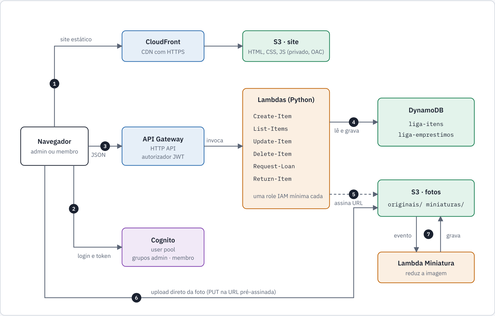

# Inventário da liga acadêmica

Web app serverless na AWS para o inventário da liga: administradores cadastram itens (placas, cabos, notebooks, kits) com foto, e membros consultam o catálogo e pedem empréstimo.

Projeto de estudo de AWS, feito primeiro clicando no console e depois descrito como infraestrutura como código.

## Estrutura

| Pasta | Conteúdo |
| --- | --- |
| `src/` | Código Python das Lambdas (uma função por arquivo) |
| `site/` | Site estático em HTML e JavaScript, servido pelo CloudFront |
| `docs/` | Diagrama da arquitetura |

## Lambdas

| Arquivo | Rota ou gatilho | Quem pode |
| --- | --- | --- |
| `list_items.py` | `GET /itens` | admin e membro |
| `create_item.py` | `POST /itens` | admin |
| `update_item.py` | `PUT /itens/{itemId}` | admin |
| `delete_item.py` | `DELETE /itens/{itemId}` | admin |
| `photo_upload_url.py` | `POST /itens/{itemId}/foto` | admin |
| `request_loan.py` | `POST /itens/{itemId}/emprestimo` | admin e membro |
| `return_item.py` | `POST /itens/{itemId}/devolucao` | quem pegou o item ou admin |
| `make_thumbnail.py` | evento do S3 em `originais/*.jpg` | (automático) |
